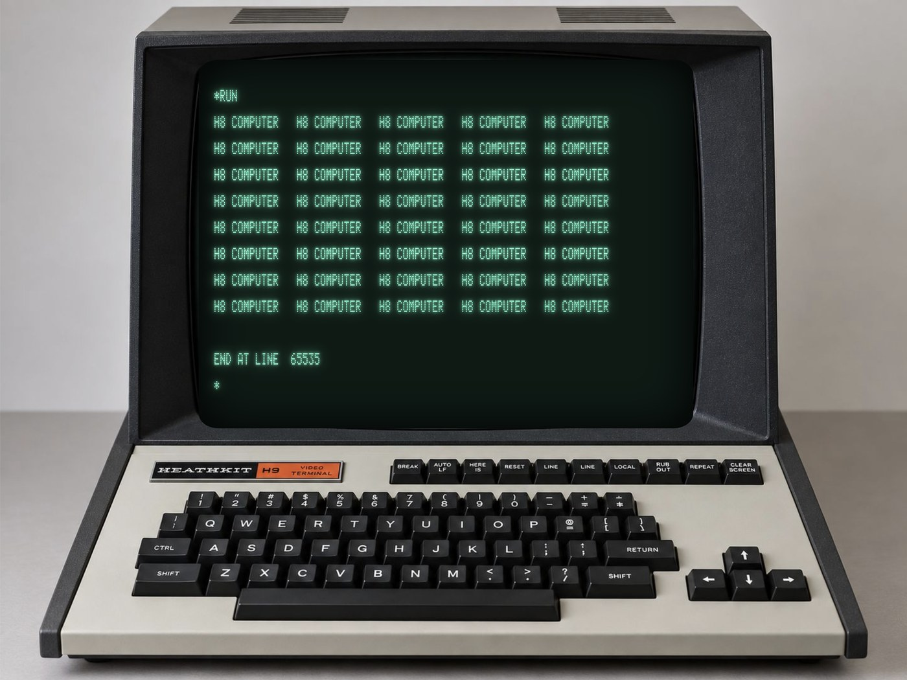

# The final H8/H9

Ein Heathkit H8 mit einem Heathkit H9 Video Terminal, komplett im Browser. Sichtbar ist nur das H9:
ein Foto des Terminals, in dessen Röhre ein lauffähiger H9-Emulator sitzt. Dahinter läuft unsichtbar
der H8 (Intel 8080A, 64 KB RAM, originales PAM-8-ROM) und bootet automatisch
**Extended Benton Harbor BASIC** (Issue #10.02.01).

*Extended BASIC auf dem H9 (Safari auf dem Mac): ein kleines Programm hat den Schirm mit „H8 COMPUTER“ gefüllt,
darunter die Meldung `END AT LINE 65535` und der `*`-Prompt.*

Alles steckt in einer einzigen Datei: `index.html` (Foto, ROM und BASIC-Band sind eingebettet).
Einfach im Browser öffnen, es braucht keinen Server.

## Bedienung

Es muss nichts angeklickt werden, die Tastatur hört auf die ganze Seite.

- Kurz nach dem Laden erscheint die Bootmeldung von Extended BASIC mit dem `*`-Prompt.
- BASIC ergänzt Schlüsselwörter beim Tippen automatisch zur kürzesten eindeutigen Abkürzung
  (`PR` wird zu `PRINT `, `RU` zu `RUN `, `LIS` zu `LIST `). Ein ausgeschriebenes `PRINT` erzeugt deshalb
  einen Fehler. Das ist das Originalverhalten. Die Abkürzung muss eindeutig sein: `LI` reicht für `LIST`
  nicht, erst `LIS` wird erkannt.
- Lokale H9-Bildschirmtasten (wirken nur auf den Schirm, nichts geht zum H8):

| Taste am PC | H9-Funktion |
| --- | --- |
| Pfeiltasten | Cursor bewegen |
| Home | HOME |
| Ende | EOL (ab Cursor bis Zeilenende löschen) |
| Bild runter | PAGE (ab Cursor bis Bildschirmende löschen) |
| Entf | ERASE (ganzen Schirm löschen) |
| Klick auf die RESET-Taste im Foto | startet den Emulator neu: H8 zurücksetzen, RAM löschen, Extended BASIC neu booten (ohne Seite neu zu laden) |

## Adress-Parameter

| Parameter | Wirkung |
| --- | --- |
| `index.html` | Original-H9: 12 Zeilen × 80 Zeichen |
| `index.html?rows=24` | historischer Ausbau auf 24 × 80 |
| `index.html?debug` | komplette H8-Oberfläche: Frontpanel, Kassettendeck, Demos, Standard-BASIC, Acey Ducey, Extended BASIC |

## Das H9

- 12 × 80 Zeichen, nur Großbuchstaben (ASCII 0x20–0x5F), kein ROM: der 5×7-Punktmatrix-Zeichensatz
  steckt im Code.
- Das Terminal nimmt vom Host nur die vier Steuerzeichen LF, CR, BS und BEL an. Escape-Sequenzen und
  Cursor-Adressierung gibt es nicht, Cursorbewegung und Löschen laufen nur über die lokalen Tasten.
- Das Terminal ist als Canvas-Überlagerung exakt über die Bildröhre des Fotos gelegt. Lage und Größe
  stehen als CSS-Variablen (`--scr-left`, `--scr-top`, `--scr-width`, `--scr-height`) am Anfang der
  `.h9-stage`-Regel.

## Der H8

- Echter Intel-8080A-Softwarekern mit 64 KB RAM, Bereich 000.000–001777 oktal als Original-PAM-8-ROM
  (Heath 444-13) schreibgeschützt.
- Konsole über die H8-5 Serial I/O Card (Intel-8251-USART) an Port 372₈/373₈, Kassette an Port 370₈/371₈.
- Das Band `EXBASIC2.H8T` (Extended Benton Harbor BASIC, Issue #10.02.01, Heath 1978) wird beim Start über
  PAM-8s eingebauten LOAD-Befehl geladen, genau wie am echten Gerät (MEM, LOAD, dann REG, 6, GO).
- Der Emulatorkern stammt aus
  [rolandkirsche/h8-h9-emulator](https://github.com/rolandkirsche/h8-h9-emulator).

## Herkunft

- ROM und Bandabbilder: SEBHC-Archiv ([github.com/sebhc/sebhc](https://github.com/sebhc/sebhc)), Heath/Wintek-Software.
  Die Rechte daran liegen bei den ursprünglichen Rechteinhabern.
- Foto des H9: vom Autor bereitgestellt.
