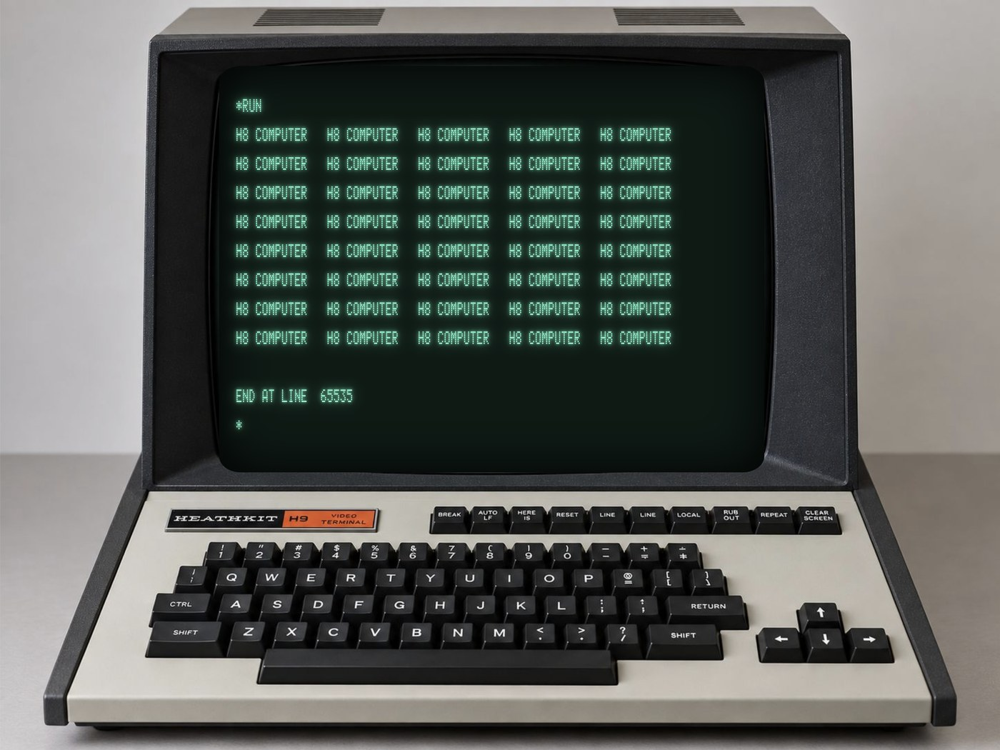

# The final H8/H9

Ein Heathkit H8 mit einem Heathkit H9 Video Terminal, komplett im Browser. Die Seite hat zwei Ansichten:

- **Seite 1 · H8** (Startansicht): Foto des H8 mit lebendem Frontpanel (Siebensegmentanzeige, Lampen,
  Tastenfeld), Kassettendeck und Knöpfen zum Laden von Demos, Benton Harbor BASIC und
  **Extended Benton Harbor BASIC** (Issue #10.02.01). Dahinter arbeitet ein Intel 8080A mit 64 KB RAM
  und dem originalen PAM-8-ROM.
- **Seite 2 · H9**: Foto des Terminals, in dessen Röhre ein lauffähiger H9-Emulator sitzt. Hier erscheint
  alles, was der H8 über die Konsole ausgibt.



*Extended BASIC auf dem H9 (Safari auf dem Mac): ein kleines Programm hat den Schirm mit „H8 COMPUTER“ gefüllt,
darunter die Meldung `END AT LINE 65535` und der `*`-Prompt.*

**Live ausprobieren:** [rolandkirsche.github.io/the-final-H8-H9](https://rolandkirsche.github.io/the-final-H8-H9/)

Alles steckt in einer einzigen Datei: `index.html` (Fotos, ROM und BASIC-Bänder sind eingebettet).
Einfach im Browser öffnen, es braucht keinen Server.

## Bedienung

Nach dem Laden steht der H8 im Monitor (PAM-8). Ein kleines Echo-Demoprogramm liegt schon ab 040.100 im RAM,
**GO (4)** startet es.

### H8-Frontpanel (Seite 1)

Die Tasten im Foto lassen sich anklicken und halten. Die PC-Tastatur wirkt auf das Panel, solange nicht der
H9-Bildschirm den Fokus hat:

| Taste am PC | H8-Taste |
| --- | --- |
| 0–7 | Ziffern (8 und 9 sind am H8 LOAD und DUMP) |
| M / R / A / C | MEM / REG / ALTER / CANCEL |
| L / D | LOAD / DUMP |
| G / S | GO (4) / SI (7) |
| + / - | + / − |
| Umschalt+0 | RTM (zurück zum Monitor) |
| Strg+0 bzw. Cmd+0 | RST/0 (Reset, RAM wird gelöscht) |

Die Knöpfe oben laden Demos, Benton Harbor BASIC, Extended BASIC oder Acey Ducey. BASIC wird dabei wie am
Original über PAM-8s LOAD-Befehl vom virtuellen Band gelesen.

### H9-Terminal (Seite 2)

Zum Tippen einmal in den Bildschirm klicken. Zurück zum H8 geht es mit der Taste **← H8** oben links
oder mit einem Klick auf LINE im Foto.

- BASIC ergänzt Schlüsselwörter beim Tippen automatisch zur kürzesten eindeutigen Abkürzung
  (`PR` wird zu `PRINT `, `RU` zu `RUN `, `LIS` zu `LIST `). Ein ausgeschriebenes `PRINT` erzeugt deshalb
  einen Fehler. Das ist das Originalverhalten. Die Abkürzung muss eindeutig sein: `LI` reicht für `LIST`
  nicht, erst `LIS` wird erkannt.
- Lokale H9-Bildschirmtasten (wirken nur auf den Schirm, nichts geht zum H8):

| Taste am PC | H9-Funktion |
| --- | --- |
| Pfeiltasten | Cursor bewegen |
| Home | HOME |
| Ende | EOL (ab Cursor bis Zeilenende löschen) |
| Bild runter | PAGE (ab Cursor bis Bildschirmende löschen) |
| Entf | ERASE (ganzen Schirm löschen) |
| F2 | tippt das BASIC-Spiel „Acey Ducey“ (Creative Computing, 1978) automatisch ein, dauert rund eine halbe Minute; danach `RU` + Enter |
| F3 | löscht das Programm im Speicher und tippt „Super Star Trek“ (Creative Computing, 1978) im Schnellmodus ein, dauert wenige Sekunden; danach `RU` + Enter |
| Klick auf die RESET-Taste im Foto | startet den Emulator neu: H8 zurücksetzen, RAM löschen, Extended BASIC neu booten (ohne Seite neu zu laden) |

## Star Trek (F3)

„Super Star Trek“ aus *BASIC Computer Games* (1978), angepasst an Extended Benton Harbor BASIC. Befehle
werden als Zahlen eingegeben, `0` zeigt die Liste:

| Zahl | Befehl |
| --- | --- |
| 1 | NAV: Kurs (1–9) und Warp-Faktor setzen |
| 2 | SRS: Kurzstreckenscan |
| 3 | LRS: Langstreckenscan |
| 4 | PHA: Phaser abfeuern |
| 5 | TOR: Photonentorpedo abfeuern |
| 6 | SHE: Schilde aufladen oder senken |
| 7 | DAM: Schadensbericht |
| 8 | COM: Bordcomputer (0–5) |
| 9 | XXX: Kommando niederlegen |

Abweichungen vom Original, alle wegen Eigenheiten dieses BASIC (Einzelheiten in `src/js/19-star-trek.js`):

- Zahlen statt der Drei-Buchstaben-Befehle, ebenso 1/0 statt Y/N: Text-`INPUT` verlangt hier Anführungszeichen.
- `x*x` statt `x^2`: `^` bricht bei negativer Basis mit `OVRFLO` ab.
- Galaxiekarte und Schadensbericht ohne Leerzeilen, damit sie auf den 12-Zeilen-Schirm passen.

Im Schnellmodus läuft die H8-CPU beim Eintippen ohne Echtzeitbremse weiter. Die Firmware verarbeitet trotzdem jedes
Zeichen selbst, einschließlich der automatischen Ergänzung von Schlüsselwörtern.

## Adress-Parameter

| Parameter | Wirkung |
| --- | --- |
| `index.html` | Original-H9: 12 Zeilen × 80 Zeichen |
| `index.html?rows=24` | historischer Ausbau auf 24 × 80 |
| `index.html?cal` | zeigt die unsichtbare Klickfläche der RESET-Taste im H9-Foto rot umrandet (zum Ausrichten) |

## Das H9

- 12 × 80 Zeichen, nur Großbuchstaben (ASCII 0x20–0x5F), kein ROM: der 5×7-Punktmatrix-Zeichensatz
  steckt im Code.
- Das Terminal nimmt vom Host nur die vier Steuerzeichen LF, CR, BS und BEL an. Escape-Sequenzen und
  Cursor-Adressierung gibt es nicht, Cursorbewegung und Löschen laufen nur über die lokalen Tasten.
- Das Terminal ist als Canvas-Überlagerung exakt über die Bildröhre des Fotos gelegt. Lage und Größe
  stehen als CSS-Variablen (`--scr-left`, `--scr-top`, `--scr-width`, `--scr-height`) am Anfang der
  `.h9-stage`-Regel.

## Der H8

- Echter Intel-8080A-Softwarekern mit 64 KB RAM, Bereich 000.000–001777 oktal als Original-PAM-8-ROM
  (Heath 444-13) schreibgeschützt.
- Konsole über die H8-5 Serial I/O Card (Intel-8251-USART) an Port 372₈/373₈, Kassette an Port 370₈/371₈.
- Das Band `EXBASIC2.H8T` (Extended Benton Harbor BASIC, Issue #10.02.01, Heath 1978) wird beim Start über
  PAM-8s eingebauten LOAD-Befehl geladen, genau wie am echten Gerät (MEM, LOAD, dann REG, 6, GO).
- Der Emulatorkern stammt aus
  [rolandkirsche/h8-h9-emulator](https://github.com/rolandkirsche/h8-h9-emulator).

## Aufbau des Repos und Build

`index.html` ist die fertige, minifizierte Einzeldatei (rund 730 KB, davon rund 450 KB das H8-Foto). Sie wird aus den Quellen gebaut:

| Pfad | Inhalt |
| --- | --- |
| `src/index.html` | HTML-Gerüst mit Meta-Tags, Favicon und den Platzhaltern für CSS, JS und Foto |
| `src/style.css`, `src/h8-authentic.css` | Layout, H9-Röhre, H8-Frontpanel auf dem Foto |
| `src/js/*.js` | Skript in 20 Modulen, in Dateinamen-Reihenfolge zusammengesetzt (CPU, ROM-Daten, I/O-Ports, H9-Terminal, Kassette, BASIC, Acey Ducey, Star Trek, …) |
| `assets/h9.webp`, `assets/h8.jpg` | Fotos von H9 und H8 (werden als `data:`-URIs eingebettet) |
| `build.py` | baut `index.html`; `python3 build.py --dev` lässt den Code lesbar |

```sh
python3 build.py        # minifiziert, wenn esbuild vorhanden ist (npm i -g esbuild@0.28.2), sonst unminifiziert
python3 build.py --dev  # lesbare Variante zum Debuggen
```

Die fertige Datei braucht keinen Server: Doppelklick (`file://`) genügt, ebenso jeder statische Webhost (z. B. GitHub Pages).
Lokal muss man nicht bauen: Bei jedem Push auf `main` baut die GitHub Action `.github/workflows/build-and-commit.yml`
die `index.html` mit esbuild 0.28.2 neu und committet sie, falls sie sich geändert hat. Wer lokal testen will, nimmt
`python3 build.py --dev` und setzt die `index.html` danach mit `git checkout index.html` zurück, sonst landet die
unminifizierte Fassung im Commit.

## Herkunft

- Super Star Trek: Bob Leedom (1974) nach Mike Mayfield, Fassung aus *BASIC Computer Games* (Creative Computing, 1978),
  Quelltext über [coding-horror/basic-computer-games](https://github.com/coding-horror/basic-computer-games).
- ROM und Bandabbilder: SEBHC-Archiv ([github.com/sebhc/sebhc](https://github.com/sebhc/sebhc)), Heath/Wintek-Software.
  Die Rechte daran liegen bei den ursprünglichen Rechteinhabern.
- Foto des H9: vom Autor bereitgestellt.
